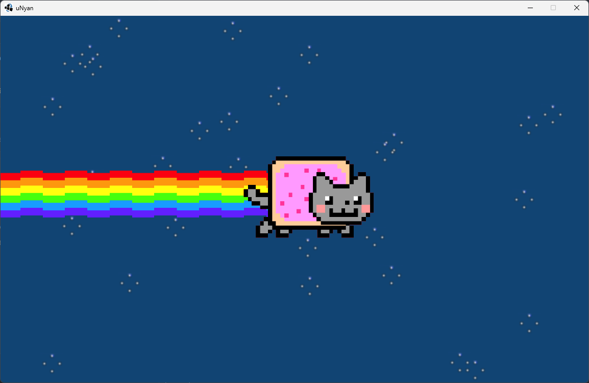
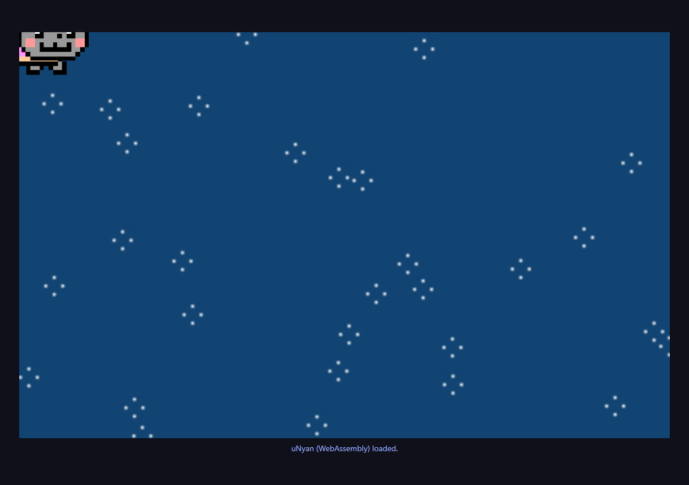

# uNyan



An interactive **Nyan Cat** demo built in Java with the
[uImpala](https://github.com/matheuscscp/uImpala) engine. The cat follows the
mouse through a space scene with an animated rainbow, stars, and looping music.

This small project demonstrates how to combine scenes, objects, animations,
mouse and keyboard input, and audio playback in uImpala. It is not a game with
levels or objectives; its purpose is to showcase these engine features.

## Demo Features

- **1152 × 720 window:** the demo runs in windowed mode and opens directly into
  the scene, without an interactive menu screen.
- **Animated Nyan Cat:** the character uses a six-frame animation and follows
  the mouse pointer inside the window.
- **Animated rainbow:** a two-frame animation repeats from the character to the
  left edge of the window, creating the colorful trail. It does not track the
  mouse's previous positions.
- **Space background:** a blue background with 30 animated stars. Some stars
  are randomly repositioned every 15 updates, adding motion to the scene.
- **Looping music:** audio from `sfx/nyan.ogg` starts automatically with the
  scene and repeats while the demo is running.
- **Low-health feedback:** the character starts with 10 health points. When
  health drops below 5, its appearance alternates between its normal colors
  and a red tint.

Health is an internal demonstration state, with no on-screen indicator. There
are no collisions, enemies, scores, or game-over conditions: reaching zero does
not end the demo, and pressing `Z` continues to decrease the value. Close and
reopen the demo to reset its initial state.

## Controls

| Input | Action |
| --- | --- |
| Move the mouse inside the window | Positions Nyan Cat and its rainbow. |
| `Z` | Decreases health by 1 per key-down event. |
| `Esc` | Exits the demo. |
| Close the window | Exits the demo. |

**Try it:** move the mouse to watch the rainbow, then press `Z` six times to
reduce health from 10 to 4 and activate the red flashing effect.

## Running in the Browser (WebAssembly)

The same demo logic also runs as a **WebAssembly (GC) module** compiled with
[TeaVM](https://teavm.org). Rendering uses the 2D canvas, input uses the DOM
and the looping music uses an HTML audio element; no plugins are needed.

The demo classes from `src/` are compiled unchanged by the web build, except
for:

- `Main` is replaced by `WebMain`: wasm builds provide the first scene
  through a factory setting (`first_scene_factory`) and cannot instantiate
  it by reflection.
- `Background` and `NyanCat` have small copies under `web/src/` that connect
  keyboard observations through a lambda
  (`Observation(Object, EventMethod)`), because TeaVM restricts
  `java.lang.reflect`. The web background also scales to fill the viewport.

The engine side is a web flavor of uImpala: `web/src/main/java` contains a
vendored, browser-compatible version of the engine core (no uOS
middleware/networking) plus a web backend
(`org.unbiquitous.uImpala.web.impl`) that implements the same engine API
over the browser APIs.



The animated scene running from the wasm module in a headless Chrome window.

### From the Terminal

```powershell
powershell.exe -NoProfile -ExecutionPolicy Bypass -File .\web\run.ps1
```

The script downloads a portable **JDK 17** and Maven 3.9.9 into
`target/tools`, compiles the wasm module, assembles the playable files into
`web/target/unyan-web/` (host page, `classes.wasm`, TeaVM runtime, `img/`,
`sfx/` and the generated `asset-manifest.txt` used by the preloader),
serves it at `http://localhost:8080/` and opens the browser.

To compile and assemble without serving:

```powershell
powershell.exe -NoProfile -ExecutionPolicy Bypass -File .\web\run.ps1 -BuildOnly
```

Then serve `web/target/unyan-web/` with any static HTTP server (for example
`powershell.exe -NoProfile -ExecutionPolicy Bypass -File .\web\serve.ps1`)
and open the page. Do not open `index.html` over `file://`: the WASM module
and the asset preloader require HTTP.

### Requirements and Notes

- A browser with **Wasm GC** support: Chrome/Edge 119+, Firefox 120+, or
  Safari 18+.
- The web scene fills the browser viewport and adapts when the window is
  resized or the device changes orientation, keeping sprites in proportion.
- Canvas rendering uses nearest-neighbor scaling to keep pixel art sharp,
  including the stars at 5× their original resolution. The solid background
  uses a 1×1 texture stretched to fill the scene.
- The music starts only after the first user gesture (browser autoplay
  policies); the demo keeps retrying on every mouse move, click or key
  press until the playback actually starts.
- OGG decodes on Chrome, Edge and Firefox; Safari does not decode OGG, so
  the music stays silent there (check the browser console for the loader
  warnings).
- The asset preloader reads `asset-manifest.txt` next to `index.html`
  (generated from `img/` and `sfx/`); failures are reported on the browser
  console.
- Esc quits the demo; a browser window does not generate close requests, so
  `Screen.isCloseRequested()` always returns false on the web build.

### Publishing on GitHub Pages

The repository contains a GitHub Actions workflow
([`.github/workflows/deploy-pages.yml`](.github/workflows/deploy-pages.yml))
that publishes this wasm build to
<https://victorgmbraga.github.io/uNyan/>. On every push to `master` (or via
the workflow's *Run workflow* button) it compiles the TeaVM module on a
Linux runner, assembles the same site as `web/run.ps1` (host page, wasm
module + runtime loader, `img/`, `sfx/` and the generated
`asset-manifest.txt`, skipping the demo screenshots and adding `.nojekyll`)
and deploys it with the official GitHub Pages actions.

One-time setup if Pages was never enabled for this repository:

1. Open **Settings → Pages** on GitHub.
2. Under *Build and deployment*, set **Source** to **GitHub Actions**.

This step has to be done in the UI: the workflow's `GITHUB_TOKEN` has no
repository-administration permission, so it cannot create the Pages site
(the API answers "Resource not accessible by integration"); once enabled,
the workflow installs new versions automatically on every push. The first
failed run can be restarted from the Actions tab (*Re-run failed jobs*).

The site keeps working there exactly as locally: all page paths are
relative, so the deployment lives under the repository subpath
(`/uNyan/`), and the same browser requirements from the notes above apply.
Note that GitHub Pages is free for public repositories; private
repositories need a GitHub Pro subscription to use Pages.

## Running on Windows

### Requirements

- 64-bit Windows with Windows PowerShell and `curl.exe` available.
- OpenGL support and audio output.
- Internet access on the first run to download tools and dependencies.

You do not need to install Java or Maven globally or modify your `PATH`.
The `run.ps1` script sets up a portable **JDK 8** and **Maven 3.9.9** in
`target/tools`.

### From Zed

1. Open the project folder in Zed.
2. Open the command palette with **Ctrl+Shift+P**.
3. Select **`task: spawn`**.
4. Select the project's uNyan run task.

The task in [`.zed/tasks.json`](.zed/tasks.json) runs the script from the project
root and explicitly uses Windows PowerShell to avoid issues with `pwsh.exe`
aliases in `WindowsApps`. You do not need to run Zed as an administrator.

### From the Terminal

Run the following command from the project root:

```powershell
powershell.exe -NoProfile -ExecutionPolicy Bypass -File .\run.ps1
```

The script sets up the tools, resolves dependencies, compiles the code,
extracts native libraries, and launches the demo. It always starts the program
from the project root so it can find `img/` and `sfx/`.

To compile and prepare dependencies without opening the window:

```powershell
powershell.exe -NoProfile -ExecutionPolicy Bypass -File .\run.ps1 -BuildOnly
```

### Legacy Dependencies and Local Cache

The demo uses `org.unbiquitous:uImpala-jse:1.0` and LWJGL 2.9.1. The original
Google Code repository was shut down, so the script recovers the libraries
from the official archive hosted by Google and configures a local mirror
without modifying `pom.xml`.

On the first run, the three ZIP downloads total approximately **265 MiB**,
in addition to Maven dependencies. The tools, recovered repository, and Maven
cache are stored in `target/tools` and reused on subsequent runs. The archived
repository may produce checksum warnings during the first build because some
artifacts do not have published checksum files.

**Warning:** deleting `target` or running `mvn clean` also removes the portable
tools and local cache. The next run will need to download them again.

## Code Structure

The demo classes are located in `src/com/victorbraga/unyan/`:

| Class | Responsibility |
| --- | --- |
| `Main` | Starts the engine and configures mouse, keyboard, video, and audio managers. |
| `Menu` | Opens the window, makes the screen and audio output available, and immediately switches to `SpaceScene`. |
| `SpaceScene` | Assembles the scene objects: background, stars, character, and music. |
| `Background` | Draws the background and handles exiting with `Esc` or closing the window. |
| `Stars` | Animates the stars and randomly changes their positions. |
| `NyanCat` | Draws the cat and rainbow, follows the mouse, and demonstrates the low-health state. |
| `Music` | Loads and plays the music on a loop. |

Visual assets are stored in `img/`, and audio is stored in `sfx/`. The `pom.xml`
file defines the Maven build, while `run.ps1` handles setup and execution on
Windows.
